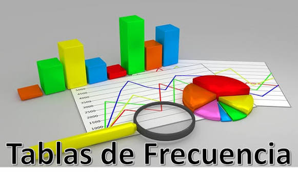

```{=html}
<div style="position: absolute; top: 10px; right: 10px;">
  
</div>
```

```{=html}
<style type="text/css">
  body {
    font-size: 130%;
    text-align: justify;
  }
</style>
```

# Cargar paquetes

```{r}
ipak <- function(pkg){
  
  # Definir repositorio CRAN (evita el error del mirror)
  options(repos = c(CRAN = "https://cloud.r-project.org"))
  
  # Identificar paquetes instalados
  installed <- rownames(installed.packages())
  
  # Identificar paquetes faltantes
  new.pkg <- setdiff(pkg, installed)
  
  # Instalar paquetes faltantes
  if(length(new.pkg) > 0){
    install.packages(new.pkg, dependencies = TRUE)
  }
  
  # Cargar paquetes sin mostrar mensajes
  invisible(lapply(pkg, function(p){
    suppressPackageStartupMessages(
      library(p, character.only = TRUE)
    )
  }))
}

# Crear la lista de los paquetes a utilizar
packages <- c("tidyverse", "kableExtra", "psych", "readxl", "stringi")

# Instalar y cargar los paquetes del listado anterior
ipak(packages)
```

[@tidyverse; @kableExtra; @psych; @readxl]

# .Introducción

**Distribución de Frecuencias**

**Concepto**

Una **distribución de frecuencias** es una forma de **organizar, resumir y presentar datos estadísticos** mediante tablas que muestran el número de observaciones que pertenecen a cada categoría o intervalo de una variable.

Formalmente, si se tiene un conjunto de datos:

$$X={x_1, x_2, x_3, \dots , x_n}$$

la distribución de frecuencias permite identificar **cuántas veces aparece cada valor o intervalo dentro del conjunto de datos**.

Las distribuciones de frecuencias se utilizan para:

- Resumir grandes volúmenes de datos
- Identificar patrones en los datos
- Facilitar la construcción de gráficos estadísticos
- Calcular medidas estadísticas (media, varianza, etc.)

**Elementos de una Distribución de Frecuencias**

Una tabla de distribución de frecuencias generalmente contiene los siguientes elementos:

| Elemento             | Descripción                          |
|----------------------|--------------------------------------|
| Clase o categoría    | Valores o intervalos de la variable  |
| Frecuencia absoluta  | Número de veces que aparece un valor |
| Frecuencia relativa  | Proporción del total                 |
| Frecuencia acumulada | Suma progresiva de frecuencias       |
| Marca de clase       | Punto medio del intervalo            |

**Frecuencia Absoluta**

La **frecuencia absoluta** indica cuántas veces aparece un valor o categoría en el conjunto de datos.

Se denota por: $f_i$

donde:

- 

  (i) representa la categoría o clase

- ($f_i$) es el número de observaciones en esa categoría

La suma de todas las frecuencias absolutas es igual al tamaño de la muestra:

$$\sum_{i=1}^{k} f_i = n$$

donde:

- 

  (k) = número de clases

- 

  (n) = número total de observaciones

**Frecuencia Relativa**

La **frecuencia relativa** representa la proporción de datos que pertenecen a una categoría.

$$h_i = \frac{f_i}{n}$$

donde:

- ($h_i$) = frecuencia relativa
- ($f_i$) = frecuencia absoluta
- ($n$) = total de observaciones

La suma de todas las frecuencias relativas es:

$$\sum_{i=1}^{k} h_i = 1$$

Si se expresa en porcentaje:

$$h_{i}(\%) = \frac{f_{i}}{n} \times 100$$

**Frecuencia Acumulada**

La **frecuencia acumulada** corresponde a la suma progresiva de las frecuencias absolutas hasta una clase determinada.

$$
F_i = \sum_{j=1}^{i} f_j
$$

Propiedades:

$$
F_k = n
$$

La frecuencia acumulada permite responder preguntas como:

- ¿Cuántos datos son **menores o iguales** que cierto valor?

**Frecuencia Relativa Acumulada**

La **frecuencia relativa acumulada** se obtiene acumulando las frecuencias relativas:

$$
H_i = \sum_{j=1}^{i} h_j
$$

También puede calcularse como:

$$
H_i = \frac{F_i}{n}
$$

**Propiedad:**

$$
H_k = 1
$$

**Distribución de Frecuencias para Datos Agrupados**

Cuando el conjunto de datos es grande, se agrupan en **intervalos o clases**.

Un intervalo se define como:

$$(L_i, L_s)$$

donde:

- (Li) = límite inferior
- (Ls) = límite superior

**Número de Clases (Regla de Sturges)**

Para determinar el número adecuado de clases se usa frecuentemente la **regla de Sturges**:

$$k = 1 + 3.322 \log\_{10}(n)$$

donde:

- 

  (k) = número de clases

- 

  (n) = tamaño de la muestra

**Amplitud de Clase**

La **amplitud de clase** es el tamaño de cada intervalo.

$$A = \frac{R}{k}$$

donde:

- 

  (R) = rango de los datos

- 

  (k) = número de clases

El rango se calcula como:

$$R = X\_{max} - X\_{min}$$

**Marca de Clase**

La **marca de clase** es el punto medio del intervalo y se utiliza para cálculos estadísticos.

$$x_i = \frac{L_i + L_s}{2}$$

**Representaciones Gráficas**

A partir de una distribución de frecuencias se pueden construir:

- **Histograma**
- **Polígono de frecuencias**
- **Ojiva (frecuencia acumulada)**
- **Gráfico de barras**
- **Gráfico circular**

Estas representaciones permiten **visualizar la estructura de los datos y su distribución**.

# .Bajar el Dataset

[Base de datos deporte](https://docs.google.com/spreadsheets/d/10_iRbA3KHNs8x9H53i-0NitNIPofXnyL/edit?usp=sharing&ouid=100778128111291248332&rtpof=true&sd=true)

# .Leer el Dataset

```{r}
deporte <- read_excel("deporte.xlsx")
```

# .Conocer el Dataset

- Mostrar algunas filas del dataset

```{r}
head(deporte)
```

- Numero de variables

```{r}
deporte %>% names %>% length()
```

- Nombres de las variables

```{r}
names(deporte)
```

- Estructura de las variables

```{r}
glimpse(deporte)
```

- Transformar las variables

```{r}

deporte$GENERO <- as.factor(deporte$GENERO)
deporte$DEPORTE <- as.factor(deporte$DEPORTE)

deporte$ESCOLARIDAD <- factor(deporte$ESCOLARIDAD, 
                        levels = c("Primaria", "Secundaria", "Pregrado", "Posgrado"), ordered = TRUE)


deporte$DESEMPEÑO <- factor(deporte$DESEMPEÑO, 
                         levels = c("Bajo", "Medio", "Alto"), ordered = TRUE)

```

- Nueva estructura de las variables

```{r}
glimpse(deporte)
```

# .Tablas y Graficas

## .Variable Nominal

::: callout-warning
La variable nominal tiene solo frecuencia absoluta, relativa y porcentaje
:::

**Análisis de frecuencias del género de los encuestados**

::: panel-tabset
## Tabla

```{r}
# Crear la tabla original
tabla <- tibble(Genero = deporte$GENERO) %>% 
  group_by(Genero) %>% 
  summarise(fi = n()) %>%
  mutate(
    hi = round(fi/sum(fi), 4), 
    Porcentaje = paste0(hi*100, "%"),)

# Convertir las columnas a character para evitar conflictos
tabla <- tabla %>% mutate(
  Genero = as.character(Genero))

# Añadir la fila de totales
totales <- tibble(
  Genero = "Total",
  fi = sum(tabla$fi),
  hi = round(sum(tabla$hi), 4),
  Porcentaje = paste0(round(sum(tabla$hi) * 100, 2), "%"))

# Combinar la tabla con los totales
tabla_final <- bind_rows(tabla, totales)

# Mostrar la tabla final con kable
tabla_final %>% 
  knitr::kable(
    col.names = c("Genero", "$f_i$", "$h_i$", "Porcentaje"), 
    align = c("l", "c", "c", "c"))
```

## Barras

```{r}
# Cargar las librerías necesarias
library(ggplot2)
library(dplyr)
library(readxl)


# Calcular los porcentajes de cada categoría en la variable GENERO
genero_counts <- deporte %>%
  dplyr::count(GENERO) %>%
  mutate(porcentaje = n / sum(n) * 100)

# Crear el diagrama de barras
ggplot(genero_counts, aes(x = GENERO, y = porcentaje, fill = GENERO)) +
  geom_bar(stat = "identity") +
  labs(title = "Distribución porcentual del genero de los encuestados", 
       x = "Genero", 
       y = "Porcentaje") +
  theme_minimal() +
  theme(legend.position = "none") +
  geom_text(aes(label = sprintf("%.1f%%", porcentaje)), 
            vjust = -0.5, 
            color = "black", 
            size = 3.5)
```

## Sectores

```{r}
# Cargar las librerías necesarias
library(ggplot2)
library(dplyr)
library(readxl)


# Calcular los porcentajes de cada categoría en la variable GENERO
genero_counts <- deporte %>%
  dplyr::count(GENERO) %>%
  mutate(porcentaje = n / sum(n) * 100)

# Crear el diagrama circular
ggplot(genero_counts, aes(x = "", y = porcentaje, fill = GENERO)) +
  geom_bar(stat = "identity", width = 1) +
  coord_polar("y") +
  labs(title = "Distribución porcentual del genero de los encuestados") +
  theme_minimal() +
  theme(axis.title.x = element_blank(),
        axis.title.y = element_blank(),
        panel.grid = element_blank(),
        axis.text.x = element_blank()) +
  geom_text(aes(label = sprintf("%.1f%%", porcentaje)), 
            position = position_stack(vjust = 0.5), 
            color = "white", 
            size = 4)
```

## Interpretación

La tabla muestra la distribución de una población de 200 personas según el género. Se observa que el grupo masculino es ligeramente mayoritario, con 107 individuos que representan el 53.5% del total, mientras que el grupo femenino está conformado por 93 personas, equivalentes al 46.5%. Aunque la diferencia no es muy amplia, sí indica una mayor presencia de hombres en la muestra. En conjunto, ambas categorías suman el 100% de la población analizada, lo que refleja una distribución completa y sin datos faltantes.
:::

<br>

**Análisis de frecuencias del deporte que más se práctica**

::: panel-tabset
## Tabla

```{r}
# Crear la tabla original
tabla <- tibble(Deporte = deporte$DEPORTE) %>% 
  group_by(Deporte) %>% 
  summarise(fi = n()) %>%
  mutate(
    hi = round(fi/sum(fi), 4), 
    Porcentaje = paste0(hi*100, "%"),)

# Convertir las columnas a character para evitar conflictos
tabla <- tabla %>% mutate(
  Deporte = as.character(Deporte))

# Añadir la fila de totales
totales <- tibble(
  Deporte = "Total",
  fi = sum(tabla$fi),
  hi = round(sum(tabla$hi), 4),
  Porcentaje = paste0(round(sum(tabla$hi) * 100, 2), "%"))

# Combinar la tabla con los totales
tabla_final <- bind_rows(tabla, totales)

# Mostrar la tabla final con kable
tabla_final %>% 
  knitr::kable(
    col.names = c("Deporte", "$f_i$", "$h_i$", "Porcentaje"), 
    align = c("l", "c", "c", "c"))
```

## Barras

```{r}
# Cargar las librerías necesarias
library(ggplot2)
library(dplyr)
library(readxl)


# Calcular los porcentajes de cada categoría en la variable DEPORTE
deporte_counts <- deporte %>%
  dplyr::count(DEPORTE) %>%
  mutate(porcentaje = n / sum(n) * 100)

# Crear el diagrama de barras
ggplot(deporte_counts, aes(x = DEPORTE, y = porcentaje, fill = DEPORTE)) +
  geom_bar(stat = "identity") +
  labs(title = "Distribución porcentual del deporte", 
       x = "Deporte", 
       y = "Porcentaje") +
  theme_minimal() +
  theme(legend.position = "none") +
  geom_text(aes(label = sprintf("%.1f%%", porcentaje)), 
            vjust = -0.5, 
            color = "black", 
            size = 3.5)
```

## Sectores

```{r}
# Cargar las librerías necesarias
library(ggplot2)
library(dplyr)
library(readxl)


# Calcular los porcentajes de cada categoría en la variable ESCOLARIDAD
deporte_counts <- deporte %>%
  dplyr::count(DEPORTE) %>%
  mutate(porcentaje = n / sum(n) * 100)

# Crear el diagrama circular
ggplot(deporte_counts, aes(x = "", y = porcentaje, fill = DEPORTE)) +
  geom_bar(stat = "identity", width = 1) +
  coord_polar("y") +
  labs(title = "Distribución porcentual del deporte") +
  theme_minimal() +
  theme(axis.title.x = element_blank(),
        axis.title.y = element_blank(),
        panel.grid = element_blank(),
        axis.text.x = element_blank()) +
  geom_text(aes(label = sprintf("%.1f%%", porcentaje)), 
            position = position_stack(vjust = 0.5), 
            color = "white", 
            size = 4)
```

## Interpretación

La tabla muestra la distribución de preferencias deportivas en una muestra de 200 personas. Se observa que el deporte más practicado es el baloncesto, con 36 individuos que representan el 18% del total, seguido de la natación con 32 personas (16%) y el fútbol con 31 (15.5%). En un nivel intermedio se encuentran el voleibol con 28 participantes (14%) y la gimnasia con 26 (13%). Por otro lado, el atletismo cuenta con 25 personas (12.5%), mientras que el tenis es el deporte menos practicado, con 22 individuos que equivalen al 11%. En general, la distribución es relativamente equilibrada entre las distintas disciplinas, aunque se destaca una ligera preferencia por el baloncesto dentro del grupo analizado.
:::

<br>

## .Variable Ordinal

::: callout-tip
La variable ordinal tiene los cuatro tipos de frecuencias
:::

**Distribución de frecuencias de los encuestados según el nivel de escolaridad**

::: panel-tabset
## Tabla

```{r}
# Crear la tabla original
tabla <- tibble(Escolaridad = deporte$ESCOLARIDAD) %>% 
  group_by(Escolaridad) %>% 
  summarise(fi = n()) %>%
  mutate(
    hi = round(fi/sum(fi), 4), 
    Porcentaje = paste0(hi*100, "%"),
    Fi = cumsum(fi),
    Hi = cumsum(hi)
  )

# Convertir las columnas Fucion, Fi, y Hi a character para evitar conflictos
tabla <- tabla %>% mutate(
  Escolaridad = as.character(Escolaridad),
  Fi = as.character(Fi),
  Hi = as.character(Hi)
)

# Añadir la fila de totales, dejando Fi y Hi vacíos
totales <- tibble(
  Escolaridad = "Total",
  fi = sum(tabla$fi),
  hi = round(sum(tabla$hi), 4),
  Porcentaje = paste0(round(sum(tabla$hi) * 100, 2), "%"),
  Fi = "",  # Puedes dejar en blanco o usar un valor numérico
  Hi = ""   # Puedes dejar en blanco o usar un valor numérico
)

# Combinar la tabla con los totales
tabla_final <- bind_rows(tabla, totales)

# Mostrar la tabla final con kable
tabla_final %>% 
  knitr::kable(
    col.names = c("Nivel Escolaridad", "fi", "hi", "Porcentaje", "Fi", "Hi"), 
    align = c("l", "c", "c", "c", "c", "c")
  )
```

## Barras

```{r}
# Cargar las librerías necesarias
library(ggplot2)
library(dplyr)
library(readxl)


# Calcular los porcentajes de cada categoría en la variable DEPORTE
escolaridad_counts <- deporte %>%
  dplyr::count(ESCOLARIDAD) %>%
  mutate(porcentaje = n / sum(n) * 100)

# Crear el diagrama de barras
ggplot(escolaridad_counts, aes(x = ESCOLARIDAD, y = porcentaje, fill = ESCOLARIDAD)) +
  geom_bar(stat = "identity") +
  labs(title = "Distribución porcentual del nivel de escolaridad", 
       x = "Nivel de Escolaridad", 
       y = "Porcentaje") +
  theme_minimal() +
  theme(legend.position = "none") +
  geom_text(aes(label = sprintf("%.1f%%", porcentaje)), 
            vjust = -0.5, 
            color = "black", 
            size = 3.5)
```

## Interpretacion

La tabla presenta la distribución del nivel de escolaridad en una muestra de 200 personas. Se observa que el nivel con mayor frecuencia es el posgrado, con 56 individuos que representan el 28% del total, seguido del pregrado con 53 personas (26.5%). En niveles intermedios, la secundaria agrupa a 47 individuos, equivalentes al 23.5%, mientras que la primaria presenta la menor proporción con 44 personas (22%). En términos acumulados, se puede notar que hasta el nivel de secundaria se concentra el 45.5% de la población, y al incluir el pregrado se alcanza el 72%, lo que indica que la mayoría de los individuos posee al menos estudios superiores. En general, la distribución muestra una tendencia hacia niveles educativos más altos dentro de la muestra analizada.
:::

**Distribución de frecuencias de los enccuestados según el desempeño en el deporte que práctica**

::: panel-tabset
## Tabla

```{r}
# Crear la tabla original
tabla <- tibble(Desempeño = deporte$DESEMPEÑO) %>% 
  group_by(Desempeño) %>% 
  summarise(fi = n()) %>%
  mutate(
    hi = round(fi/sum(fi), 4), 
    Porcentaje = paste0(hi*100, "%"),
    Fi = cumsum(fi),
    Hi = cumsum(hi)
  )

# Convertir las columnas Fucion, Fi, y Hi a character para evitar conflictos
tabla <- tabla %>% mutate(
  Desempeño = as.character(Desempeño),
  Fi = as.character(Fi),
  Hi = as.character(Hi)
)

# Añadir la fila de totales, dejando Fi y Hi vacíos
totales <- tibble(
  Desempeño = "Total",
  fi = sum(tabla$fi),
  hi = round(sum(tabla$hi), 4),
  Porcentaje = paste0(round(sum(tabla$hi) * 100, 2), "%"),
  Fi = "",  # Puedes dejar en blanco o usar un valor numérico
  Hi = ""   # Puedes dejar en blanco o usar un valor numérico
)

# Combinar la tabla con los totales
tabla_final <- bind_rows(tabla, totales)

# Mostrar la tabla final con kable
tabla_final %>% 
  knitr::kable(
    col.names = c("Desempeño", "fi", "hi", "Porcentaje", "Fi", "Hi"), 
    align = c("l", "c", "c", "c", "c", "c")
  )
```

## Barras

```{r}
# Cargar las librerías necesarias
library(ggplot2)
library(dplyr)
library(readxl)


# Calcular los porcentajes de cada categoría en la variable DEPORTE
desempeño_counts <- deporte %>%
  dplyr::count(DESEMPEÑO) %>%
  mutate(porcentaje = n / sum(n) * 100)

# Crear el diagrama de barras
ggplot(desempeño_counts, aes(x = DESEMPEÑO, y = porcentaje, fill = DESEMPEÑO)) +
  geom_bar(stat = "identity") +
  labs(title = "Distribución porcentual del desempeño en el deporte", 
       x = "Desempeño", 
       y = "Porcentaje") +
  theme_minimal() +
  theme(legend.position = "none") +
  geom_text(aes(label = sprintf("%.1f%%", porcentaje)), 
            vjust = -0.5, 
            color = "black", 
            size = 3.5)
```

## Interpretacion

La tabla muestra la distribución del desempeño de 200 individuos en tres niveles: bajo, medio y alto. Se observa que el grupo más numeroso es el de desempeño alto, con 72 personas, lo que representa el 36% del total. Le sigue el nivel bajo con 67 personas (33.5%), y finalmente el nivel medio con 61 personas (30.5%), siendo este el menos frecuente. En términos acumulados, hasta el nivel medio se concentra el 64% de los casos, mientras que al incluir el nivel alto se alcanza el 100%. En general, la distribución es bastante equilibrada, aunque se aprecia una ligera tendencia hacia desempeños altos.
:::

<br>

## .Variable Discreta

::: callout-warning
La variable discreta tiene los cuatro tipos de frecuencias
:::

**Distribución de frecuencias de los encuestados según el número de prácticas en el deporte**

::: panel-tabset
## Tabla

```{r}
# Crear la tabla original
tabla <- tibble(Practicas = deporte$PRACTICAS) %>% 
  group_by(Practicas) %>% 
  summarise(fi = n()) %>%
  mutate(
    hi = round(fi/sum(fi), 4), 
    Porcentaje = paste0(hi*100, "%"),
    Fi = cumsum(fi),
    Hi = cumsum(hi)
  )

# Convertir las columnas Personas, Fi, y Hi a character para evitar conflictos
tabla <- tabla %>% mutate(
  Practicas = as.character(Practicas),
  Fi = as.character(Fi),
  Hi = as.character(Hi)
)

# Añadir la fila de totales, dejando Fi y Hi vacíos
totales <- tibble(
  Practicas = "Total",
  fi = sum(tabla$fi),
  hi = round(sum(tabla$hi), 2),
  Porcentaje = paste0(round(sum(tabla$hi) * 100, 2), "%"),
  Fi = "",  # Puedes dejar en blanco o usar un valor numérico
  Hi = ""   # Puedes dejar en blanco o usar un valor numérico
)

# Combinar la tabla con los totales
tabla_final <- bind_rows(tabla, totales)

# Mostrar la tabla final con kable
tabla_final %>% 
  knitr::kable(
    col.names = c("N Practicas", "fi", "hi", "Porcentaje", "Fi", "Hi"), 
    align = c("l", "r", "r", "r", "r", "r")
  )

```

## Bastones

```{r}
# valores de la variable
x <- c(1, 2, 3, 4, 5, 6, 7)
# f.m.p.
fx <- c(0.135, 0.130, 0.110, 0.165, 0.145, 0.165, 0.150)

# Crear un dataframe con los datos
df <- data.frame(x = x, fx = fx)

# Gráfico con ggplot2
ggplot(df, aes(x = x, y = fx)) +
  geom_point(shape = 18, color = "red") +
  geom_segment(aes(xend = x, yend = 0), size = 1, color = "blue") +
  labs(x = "N Practicas", y = "Porcentaje", title = "Diagrama  de bastones") +
  theme_minimal() +
  geom_text(aes(label = fx), vjust = -0.5)
```

## Escalonado

```{r}
# Cargar librerías
library(ggplot2)
library(tibble)

# Crear datos
df <- tibble(
  x = c(1, 2, 3, 4, 5, 6, 7),
  Hi = c(0.135, 0.265, 0.375, 0.54, 0.685, 0.85, 1)
)

# Gráfica de función de distribución acumulada
ggplot(df, aes(x = x, y = Hi)) +
  geom_step(color = "#2C3E50", size = 1.2) +        # línea escalonada (CDF)
  geom_point(color = "#E74C3C", size = 3) +         # puntos
  scale_x_continuous(breaks = df$x) +
  scale_y_continuous(limits = c(0, 1)) +
  labs(
    title = "Función de Distribución Acumulada (FDA)",
    x = "N Practicas",
    y = "Frecuencia relativa acumulada (Hi)"
  ) +
  theme_minimal(base_size = 14) +
  theme(
    plot.title = element_text(face = "bold", hjust = 0.5),
    panel.grid.minor = element_blank()
  )
```

## Interpretacion

La tabla presenta la distribución del número de prácticas realizadas por 200 individuos, mostrando una variación entre 1 y 7 prácticas. Se observa que las frecuencias están relativamente equilibradas, aunque los valores más altos se concentran en 4 y 6 prácticas, con 33 personas cada uno, representando el 16.5% respectivamente. En contraste, el menor número de casos corresponde a 3 prácticas, con 22 personas (11%). En términos acumulados, el 54% de los individuos ha realizado hasta 4 prácticas, mientras que el 85% ha completado hasta 6, y el total se alcanza al considerar las 7 prácticas. En general, la distribución sugiere que la mayoría de los participantes realiza un número intermedio a alto de prácticas, sin que exista una concentración extrema en un solo valor.
:::

**Distribución de frecuencias de los encuestados según el número de lesiones**

::: panel-tabset
## Tabla

```{r}
# Crear la tabla original
tabla <- tibble(Lesiones = deporte$LESIONES) %>% 
  group_by(Lesiones) %>% 
  summarise(fi = n()) %>%
  mutate(
    hi = round(fi/sum(fi), 4), 
    Porcentaje = paste0(hi*100, "%"),
    Fi = cumsum(fi),
    Hi = cumsum(hi)
  )

# Convertir las columnas Personas, Fi, y Hi a character para evitar conflictos
tabla <- tabla %>% mutate(
  Lesiones = as.character(Lesiones),
  Fi = as.character(Fi),
  Hi = as.character(Hi)
)

# Añadir la fila de totales, dejando Fi y Hi vacíos
totales <- tibble(
  Lesiones = "Total",
  fi = sum(tabla$fi),
  hi = round(sum(tabla$hi), 2),
  Porcentaje = paste0(round(sum(tabla$hi) * 100, 2), "%"),
  Fi = "",  # Puedes dejar en blanco o usar un valor numérico
  Hi = ""   # Puedes dejar en blanco o usar un valor numérico
)

# Combinar la tabla con los totales
tabla_final <- bind_rows(tabla, totales)

# Mostrar la tabla final con kable
tabla_final %>% 
  knitr::kable(
    col.names = c("N Lesiones", "fi", "hi", "Porcentaje", "Fi", "Hi"), 
    align = c("l", "r", "r", "r", "r", "r")
  )

```

## Bastones

```{r}
# valores de la variable
x <- c(0, 1, 2, 3)
# f.m.p.
fx <- c(0.280, 0.210, 0.295, 0.215)

# Crear un dataframe con los datos
df <- data.frame(x = x, fx = fx)

# Gráfico con ggplot2
ggplot(df, aes(x = x, y = fx)) +
  geom_point(shape = 18, color = "red") +
  geom_segment(aes(xend = x, yend = 0), size = 1, color = "blue") +
  labs(x = "N Lesiones", y = "Porcentaje", title = "Diagrama  de bastones") +
  theme_minimal() +
  geom_text(aes(label = fx), vjust = -0.5)
```

## Escalonado

```{r}
# Cargar librerías
library(ggplot2)
library(tibble)

# Crear datos
df <- tibble(
  x = c(0, 1, 2, 3),
  Hi = c(0.28, 0.49, 0.785, 1)
)

# Gráfica de función de distribución acumulada
ggplot(df, aes(x = x, y = Hi)) +
  geom_step(color = "#2C3E50", size = 1.2) +        # línea escalonada (CDF)
  geom_point(color = "#E74C3C", size = 3) +         # puntos
  scale_x_continuous(breaks = df$x) +
  scale_y_continuous(limits = c(0, 1)) +
  labs(
    title = "Función de Distribución Acumulada (FDA)",
    x = "N Lesiones",
    y = "Frecuencia relativa acumulada (Hi)"
  ) +
  theme_minimal(base_size = 14) +
  theme(
    plot.title = element_text(face = "bold", hjust = 0.5),
    panel.grid.minor = element_blank()
  )
```

## Interpretacion

La tabla muestra la distribución del número de lesiones en una muestra de 200 individuos. Se observa que la categoría más frecuente es la de 2 lesiones, con 59 casos, lo que representa el 29.5% del total. Le sigue el grupo sin lesiones (0), con 56 personas (28%), lo que indica que una proporción importante no ha sufrido lesiones. Por otro lado, quienes presentan 1 y 3 lesiones tienen frecuencias similares, con 42 (21%) y 43 (21.5%) casos respectivamente. En términos acumulados, el 49% de los individuos presenta como máximo una lesión, mientras que el 78.5% tiene hasta dos lesiones, alcanzando el 100% al incluir tres lesiones. En general, la distribución es relativamente equilibrada, aunque se aprecia una ligera concentración en quienes presentan dos lesiones, lo que sugiere una tendencia hacia niveles moderados de afectación.
:::

**Distribución de frecuencias de los encuestados según la escala de BORG**

::: panel-tabset
## Tabla

```{r}
# Crear la tabla original
tabla <- tibble(Borg = deporte$BORG) %>% 
  group_by(Borg) %>% 
  summarise(fi = n()) %>%
  mutate(
    hi = round(fi/sum(fi), 4), 
    Porcentaje = paste0(hi*100, "%"),
    Fi = cumsum(fi),
    Hi = cumsum(hi)
  )

# Convertir las columnas Personas, Fi, y Hi a character para evitar conflictos
tabla <- tabla %>% mutate(
  Borg = as.character(Borg),
  Fi = as.character(Fi),
  Hi = as.character(Hi)
)

# Añadir la fila de totales, dejando Fi y Hi vacíos
totales <- tibble(
  Borg = "Total",
  fi = sum(tabla$fi),
  hi = round(sum(tabla$hi), 2),
  Porcentaje = paste0(round(sum(tabla$hi) * 100, 2), "%"),
  Fi = "",  # Puedes dejar en blanco o usar un valor numérico
  Hi = ""   # Puedes dejar en blanco o usar un valor numérico
)

# Combinar la tabla con los totales
tabla_final <- bind_rows(tabla, totales)

# Mostrar la tabla final con kable
tabla_final %>% 
  knitr::kable(
    col.names = c("Escala de BORG", "fi", "hi", "Porcentaje", "Fi", "Hi"), 
    align = c("l", "r", "r", "r", "r", "r")
  )

```

## Bastones

```{r}
# valores de la variable
x <- c(0, 1, 2, 3, 4, 5, 6, 7, 8, 9, 10)
# f.m.p.
fx <- c(0.100, 0.065, 0.070, 0.100, 0.095, 0.095, 0.105, 0.065, 0.115, 0.090, 0.100)

# Crear un dataframe con los datos
df <- data.frame(x = x, fx = fx)

# Gráfico con ggplot2
ggplot(df, aes(x = x, y = fx)) +
  geom_point(shape = 18, color = "red") +
  geom_segment(aes(xend = x, yend = 0), size = 1, color = "blue") +
  labs(x = "Escala de BORG", y = "Porcentaje", title = "Diagrama  de bastones") +
  theme_minimal() +
  geom_text(aes(label = fx), vjust = -0.5)
```

## Escalonado

```{r}
# Cargar librerías
library(ggplot2)
library(tibble)

# Crear datos
df <- tibble(
  x = c(0, 1, 2, 3, 4, 5, 6, 7, 8, 9, 10),
  Hi = c(0.1, 0.165, 0.235, 0.335, 0.43, 0.525, 0.63, 0.695, 0.81, 0.9, 1)
)

# Gráfica de función de distribución acumulada
ggplot(df, aes(x = x, y = Hi)) +
  geom_step(color = "#2C3E50", size = 1.2) +        # línea escalonada (CDF)
  geom_point(color = "#E74C3C", size = 3) +         # puntos
  scale_x_continuous(breaks = df$x) +
  scale_y_continuous(limits = c(0, 1)) +
  labs(
    title = "Función de Distribución Acumulada (FDA)",
    x = "Escala de BORG",
    y = "Frecuencia relativa acumulada (Hi)"
  ) +
  theme_minimal(base_size = 14) +
  theme(
    plot.title = element_text(face = "bold", hjust = 0.5),
    panel.grid.minor = element_blank()
  )
```

## Interpretacion

La tabla muestra la distribución de respuestas en la escala de Borg para una muestra total de 200 observaciones. Se observa que los valores están relativamente dispersos a lo largo de toda la escala (de 0 a 10), sin una concentración extrema en un solo punto. Sin embargo, destacan ligeramente los niveles 6 (10.5%) y 8 (11.5%) como los más frecuentes, lo que sugiere que una parte importante de los participantes percibe un esfuerzo moderado-alto. Asimismo, los valores intermedios (4, 5 y 6) acumulan una proporción considerable de respuestas, indicando que la mayoría se sitúa en niveles medios de esfuerzo percibido. Por otro lado, los extremos de la escala (0 y 10) también presentan porcentajes relativamente altos (10% cada uno), lo que refleja cierta variabilidad en las percepciones individuales. En términos acumulados, el 52.5% de los participantes se ubica hasta el nivel 5, mientras que el 47.5% restante se concentra en niveles superiores, lo que sugiere una distribución bastante equilibrada, con una ligera tendencia hacia esfuerzos moderados a altos.
:::

**Distribución de frecuencias de los encuestdos según la escala EVA**

::: panel-tabset
## Tabla

```{r}
# Crear la tabla original
tabla <- tibble(Eva = deporte$EVA) %>% 
  group_by(Eva) %>% 
  summarise(fi = n()) %>%
  mutate(
    hi = round(fi/sum(fi), 4), 
    Porcentaje = paste0(hi*100, "%"),
    Fi = cumsum(fi),
    Hi = cumsum(hi)
  )

# Convertir las columnas Personas, Fi, y Hi a character para evitar conflictos
tabla <- tabla %>% mutate(
  Eva = as.character(Eva),
  Fi = as.character(Fi),
  Hi = as.character(Hi)
)

# Añadir la fila de totales, dejando Fi y Hi vacíos
totales <- tibble(
  Eva = "Total",
  fi = sum(tabla$fi),
  hi = round(sum(tabla$hi), 2),
  Porcentaje = paste0(round(sum(tabla$hi) * 100, 2), "%"),
  Fi = "",  # Puedes dejar en blanco o usar un valor numérico
  Hi = ""   # Puedes dejar en blanco o usar un valor numérico
)

# Combinar la tabla con los totales
tabla_final <- bind_rows(tabla, totales)

# Mostrar la tabla final con kable
tabla_final %>% 
  knitr::kable(
    col.names = c("Escala EVA", "fi", "hi", "Porcentaje", "Fi", "Hi"), 
    align = c("l", "r", "r", "r", "r", "r")
  )

```

## Bastones

```{r}
# valores de la variable
x <- c(0, 1, 2, 3, 4, 5)
# f.m.p.
fx <- c(0.140, 0.195, 0.175, 0.155, 0.155, 0.180)

# Crear un dataframe con los datos
df <- data.frame(x = x, fx = fx)

# Gráfico con ggplot2
ggplot(df, aes(x = x, y = fx)) +
  geom_point(shape = 18, color = "red") +
  geom_segment(aes(xend = x, yend = 0), size = 1, color = "blue") +
  labs(x = "Escala EVA", y = "Porcentaje", title = "Diagrama  de bastones") +
  theme_minimal() +
  geom_text(aes(label = fx), vjust = -0.5)
```

## Escalonado

```{r}
# Cargar librerías
library(ggplot2)
library(tibble)

# Crear datos
df <- tibble(
  x = c(0, 1, 2, 3, 4, 5),
  Hi = c(0.14, 0.335, 0.51, 0.665, 0.82, 1)
)

# Gráfica de función de distribución acumulada
ggplot(df, aes(x = x, y = Hi)) +
  geom_step(color = "#2C3E50", size = 1.2) +        # línea escalonada (CDF)
  geom_point(color = "#E74C3C", size = 3) +         # puntos
  scale_x_continuous(breaks = df$x) +
  scale_y_continuous(limits = c(0, 1)) +
  labs(
    title = "Función de Distribución Acumulada (FDA)",
    x = "Escala EVA",
    y = "Frecuencia relativa acumulada (Hi)"
  ) +
  theme_minimal(base_size = 14) +
  theme(
    plot.title = element_text(face = "bold", hjust = 0.5),
    panel.grid.minor = element_blank()
  )
```

## Interpretacion

La tabla de la escala EVA muestra la distribución de 200 respuestas en niveles que van de 0 a 5. Se observa que la mayor concentración de respuestas se encuentra en los valores bajos e intermedios, destacando especialmente el nivel 1 con un 19.5%, seguido del nivel 5 con 18% y el nivel 2 con 17.5%. En conjunto, más de la mitad de los participantes (51%) se ubica entre los niveles 0 y 2, lo que indica una tendencia general hacia percepciones bajas a moderadas. A medida que aumentan los niveles, la frecuencia se mantiene relativamente estable, aunque sin picos pronunciados en los valores más altos. En términos acumulados, el 66.5% de las respuestas se concentra hasta el nivel 3 y el 82% hasta el nivel 4, lo que refleja que la gran mayoría de los participantes no supera niveles altos en la escala. En general, la distribución sugiere una inclinación hacia valores bajos, con una disminución progresiva hacia los niveles más elevados, indicando que predominan percepciones de menor intensidad.
:::

<br>

## .Variable Continua

::: callout-important
La variable continua se tabula con intervalos
:::

<br>

**Generación de intervalos EDAD**

::: panel-tabset
## Mínimo

```{r}
Min <- min(deporte$EDAD)
Min
```

## Máximo

```{r}
Max <- max(deporte$EDAD)
Max
```

## Rango

```{r}
R <- Max-Min
R

```

## Intervalos

```{r}
m <- ceiling(1 + 3.322*log10(nrow(deporte)))
m

```

## Amplitud

```{r}
A <- ceiling((R/m) * 1) / 1
A
```

## Rango corregido

```{r}
RC <- A*m
RC
```
:::

::: callout-caution
La amplitud debe tener tanto decimales como lo tienen los datos originales. Si tiene un decimal la fórmula se multiplica y se divide por 10. Si tiene dos decimales la fórmula se multiplica y se divide por 100 y así sucesivamente
:::

::: panel-tabset
## Diferencia

```{r}
D <- RC-R
D
```

## Mínimo corregido

```{r}
Xmin <- Min-4
Xmin
```

## Máximo corregido

```{r}
Xmax <- Max+4
Xmax
```
:::

::: callout-important
La diferencia se debe dividir en dos números lo más equitativos de tal manera que estos números tengan tantos decimales como los datos originales. Al mínimo se le resta uno de los números y al máximo se le suma el otro
:::

<br>

**Distribución de frecuencias de la edad de los usuarios encuestados**

::: panel-tabset
## Tabla

```{r}
library(dplyr)
library(kableExtra)

m1 <- (Xmin+(Xmin+A))/2

interv = cut(x = deporte$EDAD, breaks = seq(Xmin, Xmax, by = A), include.lowest = TRUE)

tabla <- tibble(Edad = interv) %>% 
  group_by(Edad) %>% 
  summarise(fi = n()) %>% 
  mutate(hi = fi / sum(fi)) %>% 
  mutate(
    mi = seq(m1, by = A, length.out = n()) %>% as.character(),
  Fi = cumsum(fi) %>% as.character(),
  Hi = cumsum(fi / sum(fi)) %>% as.character()
  ) %>% 
  relocate(Edad, mi, fi)
  

# Agregar la fila total con casillas en blanco
tabla <- tabla %>% 
  add_row(Edad = "Total", mi = "", fi = sum(tabla$fi), hi = sum(tabla$hi), Fi = "", Hi = "")

# Generar la tabla con knitr::kable y agregar título
tabla %>% 
  knitr::kable(
    col.names = c("Edad", "mi", "fi", "hi", "Fi", "Hi"), 
    align = c("l", "r", "r", "r", "r", "r")
  ) %>% 
  kableExtra::kable_styling(full_width = FALSE) %>% 
  kableExtra::add_header_above(c("Distribuciones de frecuencias para la variable Edad" = 6))
```

## Histograma

```{r}
# Librerías
library(ggplot2)

# Dataframe (tus datos)
edad <- data.frame(
  li = c(26, 31, 36, 41, 46, 51, 56, 61, 66, 71),
  ls = c(31, 36, 41, 46, 51, 56, 61, 66, 71, 76),
  fi = c(29, 127, 143, 33, 33, 36, 34, 32, 31, 2)
)

# Histograma real con intervalos
ggplot(edad) +
  geom_rect(aes(
    xmin = li,
    xmax = ls,
    ymin = 0,
    ymax = fi
  ),
  fill = "steelblue",
  color = "black"
  ) +
  labs(
    title = "Histograma de la edad de los trabajadores",
    x = "Edad",
    y = "Frecuencia"
  ) +
  theme_minimal(base_size = 14) +
  theme(
    plot.title = element_text(hjust = 0.5, face = "bold")
  )
```

## Ojiva

```{r}
library(dplyr)
library(ggplot2)
library(tibble)

edad <- tibble(
  li = c(26, 31, 36, 41, 46, 51, 56, 61, 66, 71),
  ls = c(31, 36, 41, 46, 51, 56, 61, 66, 71, 76),
  fi = c(29, 127, 143, 33, 33, 36, 34, 32, 31, 2)
)

# Calcular acumuladas
edad <- edad %>% 
  mutate(
    Fi = cumsum(fi),
    Hi = Fi / sum(fi)
  )

# Graficar ojiva
ggplot(edad, aes(x = ls, y = Hi)) +
  geom_line(color = "blue", size = 1) +
  geom_point(color = "red", size = 2) +
  labs(
    title = "Ojiva de la edad de los trabajadores",
    x = "Edad (límite superior del intervalo)",
    y = "Frecuencia acumulada relativa"
  ) +
  scale_y_continuous(labels = scales::percent) +
  theme_minimal()
```

## Densidad

```{r}
# Librerías
library(dplyr)

edad <- data.frame(
  mi = c(28.5, 33.5, 38.5, 43.5, 48.5, 53.5, 58.5, 63.5, 68.5, 73.5),
  fi = c(29, 127, 143, 33, 33, 36, 34, 32, 31, 2)
)

edad_expandida <- edad %>%
  slice(rep(1:n(), fi))

dens <- density(edad_expandida$mi)

plot(dens,
     main = "Densidad",
     xlab = "Edad",
     ylab = "Densidad",
     col = "red",
     lwd = 2)

polygon(dens, col = rgb(1, 0, 0, 0.5), border = "red")
```

## Interpretación

La distribución de la edad en la muestra de 200 participantes muestra una dispersión relativamente equilibrada a lo largo de los intervalos, que van desde los 14 hasta los 64 años. Sin embargo, se observa una mayor concentración en los grupos de edad intermedia, especialmente entre los 29 y 49 años, donde se encuentran las frecuencias más altas, destacando el intervalo de 44 a 49 años con un 15%, el valor más elevado de la tabla. En contraste, los extremos presentan menor representación, particularmente los grupos de 14 a 19 años (3%) y de 59 a 64 años (2.5%). En términos acumulados, el 48% de los participantes tiene hasta 39 años, mientras que el 52% restante se ubica por encima de esta edad, lo que indica una distribución bastante equilibrada entre adultos jóvenes y adultos de mayor edad. En general, los datos reflejan una ligera tendencia hacia edades medias, con menor presencia de los grupos más jóvenes y de mayor edad.
:::

**Generación de intervalos PESO**

::: panel-tabset
## Mínimo

```{r}
Min <- min(deporte$PESO)
Min
```

## Máximo

```{r}
Max <- max(deporte$PESO)
Max
```

## Rango

```{r}
R <- Max-Min
R

```

## Intervalos

```{r}
m <- ceiling(1 + 3.322*log10(nrow(deporte)))
m

```

## Amplitud

```{r}
A <- ceiling((R/m) * 1) / 1
A
```

## Rango corregido

```{r}
RC <- A*m
RC
```
:::

::: callout-caution
La amplitud debe tener tanto decimales como lo tienen los datos originales. Si tiene un decimal la fórmula se multiplica y se divide por 10. Si tiene dos decimales la fórmula se multiplica y se divide por 100 y así sucesivamente
:::

::: panel-tabset
## Diferencia

```{r}
D <- RC-R
D
```

## Mínimo corregido

```{r}
Xmin <- Min-4
Xmin
```

## Máximo corregido

```{r}
Xmax <- Max+4
Xmax
```
:::

::: callout-important
La diferencia se debe dividir en dos números lo más equitativos de tal manera que estos números tengan tantos decimales como los datos originales. Al mínimo se le resta uno de los números y al máximo se le suma el otro
:::

<br>

**Distribución de frecuencias del peso de los usuarios encuestados**

::: panel-tabset
## Tabla

```{r}
library(dplyr)
library(kableExtra)

m1 <- (Xmin+(Xmin+A))/2

interv = cut(x = deporte$PESO, breaks = seq(Xmin, Xmax, by = A), include.lowest = TRUE)

tabla <- tibble(Peso = interv) %>% 
  group_by(Peso) %>% 
  summarise(fi = n()) %>% 
  mutate(hi = fi / sum(fi)) %>% 
  mutate(
    mi = seq(m1, by = A, length.out = n()) %>% as.character(),
  Fi = cumsum(fi) %>% as.character(),
  Hi = cumsum(fi / sum(fi)) %>% as.character()
  ) %>% 
  relocate(Peso, mi, fi)
  

# Agregar la fila total con casillas en blanco
tabla <- tabla %>% 
  add_row(Peso = "Total", mi = "", fi = sum(tabla$fi), hi = sum(tabla$hi), Fi = "", Hi = "")

# Generar la tabla con knitr::kable y agregar título
tabla %>% 
  knitr::kable(
    col.names = c("Peso", "mi", "fi", "hi", "Fi", "Hi"), 
    align = c("l", "r", "r", "r", "r", "r")
  ) %>% 
  kableExtra::kable_styling(full_width = FALSE) %>% 
  kableExtra::add_header_above(c("Distribuciones de frecuencias para la variable Peso" = 6))
```

## Histograma

```{r}
# Librerías
library(ggplot2)

# Dataframe (tus datos)
peso <- data.frame(
  li = c(44, 48, 52, 56, 60, 64, 68, 72, 76),
  ls = c(48, 52, 56, 60, 64, 68, 72, 76, 80),
  fi = c(6, 18, 22, 36, 24, 22, 33, 14, 25)
)

# Histograma real con intervalos
ggplot(peso) +
  geom_rect(aes(
    xmin = li,
    xmax = ls,
    ymin = 0,
    ymax = fi
  ),
  fill = "steelblue",
  color = "black"
  ) +
  labs(
    title = "Histograma del peso de los trabajadores",
    x = "Peso",
    y = "Frecuencia"
  ) +
  theme_minimal(base_size = 14) +
  theme(
    plot.title = element_text(hjust = 0.5, face = "bold")
  )
```

## Ojiva

```{r}
library(dplyr)
library(ggplot2)
library(tibble)

peso <- tibble(
  li = c(44, 48, 52, 56, 60, 64, 68, 72, 76),
  ls = c(48, 52, 56, 60, 64, 68, 72, 76, 80),
  fi = c(6, 18, 22, 36, 24, 22, 33, 14, 25)
)

# Calcular acumuladas
peso <- peso %>% 
  mutate(
    Fi = cumsum(fi),
    Hi = Fi / sum(fi)
  )

# Graficar ojiva
ggplot(peso, aes(x = ls, y = Hi)) +
  geom_line(color = "blue", size = 1) +
  geom_point(color = "red", size = 2) +
  labs(
    title = "Ojiva del peso de los trabajadores",
    x = "Peso (límite superior del intervalo)",
    y = "Frecuencia acumulada relativa"
  ) +
  scale_y_continuous(labels = scales::percent) +
  theme_minimal()
```

## Densidad

```{r}
# Librerías
library(dplyr)

peso <- data.frame(
  mi = c(46, 50, 54, 58, 62, 66, 70, 74, 78),
  fi = c(6, 18, 22, 36, 24, 22, 33, 14, 25)
)

peso_expandido <- peso %>%
  slice(rep(1:n(), fi))

dens <- density(peso_expandido$mi)

plot(dens,
     main = "Densidad",
     xlab = "Peso",
     ylab = "Densidad",
     col = "red",
     lwd = 2)

polygon(dens, col = rgb(1, 0, 0, 0.5), border = "red")
```

## Interpretación

La tabla presenta una distribución de frecuencias del peso agrupado en intervalos, con un total de 200 observaciones. Se puede ver que el intervalo con mayor frecuencia es (56,60\], con 36 personas (18%), lo que indica que la mayor concentración de datos se encuentra alrededor de ese rango. A medida que aumentan los intervalos, las frecuencias tienden a fluctuar, pero en general se observa que la mayoría de los valores se concentran entre 52 y 72, donde se acumula más del 80% de los datos (Hi ≈ 0.805). Además, la frecuencia acumulada muestra que el 53% de las observaciones no supera los 64, lo que sugiere una distribución relativamente centrada en valores medios. En conjunto, la tabla indica que los pesos están distribuidos de manera moderadamente concentrada en el rango medio, sin una dispersión extrema hacia los valores más bajos o más altos.
:::

**Generación de intervalos CINTURA**

::: panel-tabset
## Mínimo

```{r}
Min <- min(deporte$CINTURA)
Min
```

## Máximo

```{r}
Max <- max(deporte$CINTURA)
Max
```

## Rango

```{r}
R <- Max-Min
R

```

## Intervalos

```{r}
m <- ceiling(1 + 3.322*log10(nrow(deporte)))
m

```

## Amplitud

```{r}
A <- ceiling((R/m) * 1) / 1
A
```

## Rango corregido

```{r}
RC <- A*m
RC
```
:::

::: callout-caution
La amplitud debe tener tanto decimales como lo tienen los datos originales. Si tiene un decimal la fórmula se multiplica y se divide por 10. Si tiene dos decimales la fórmula se multiplica y se divide por 100 y así sucesivamente
:::

::: panel-tabset
## Diferencia

```{r}
D <- RC-R
D
```

## Mínimo corregido

```{r}
Xmin <- Min-4
Xmin
```

## Máximo corregido

```{r}
Xmax <- Max+4
Xmax
```
:::

::: callout-important
La diferencia se debe dividir en dos números lo más equitativos de tal manera que estos números tengan tantos decimales como los datos originales. Al mínimo se le resta uno de los números y al máximo se le suma el otro
:::

<br>

**Distribución de frecuencias de la cintura en cm de los usuarios encuestados**

::: panel-tabset
## Tabla

```{r}
library(dplyr)
library(kableExtra)

m1 <- (Xmin+(Xmin+A))/2

interv = cut(x = deporte$CINTURA, breaks = seq(Xmin, Xmax, by = A), include.lowest = TRUE)

tabla <- tibble(Cintura = interv) %>% 
  group_by(Cintura) %>% 
  summarise(fi = n()) %>% 
  mutate(hi = fi / sum(fi)) %>% 
  mutate(
    mi = seq(m1, by = A, length.out = n()) %>% as.character(),
  Fi = cumsum(fi) %>% as.character(),
  Hi = cumsum(fi / sum(fi)) %>% as.character()
  ) %>% 
  relocate(Cintura, mi, fi)
  

# Agregar la fila total con casillas en blanco
tabla <- tabla %>% 
  add_row(Cintura = "Total", mi = "", fi = sum(tabla$fi), hi = sum(tabla$hi), Fi = "", Hi = "")

# Generar la tabla con knitr::kable y agregar título
tabla %>% 
  knitr::kable(
    col.names = c("Cintura", "mi", "fi", "hi", "Fi", "Hi"), 
    align = c("l", "r", "r", "r", "r", "r")
  ) %>% 
  kableExtra::kable_styling(full_width = FALSE) %>% 
  kableExtra::add_header_above(c("Distribuciones de frecuencias para la variable Cintura" = 6))
```

## Histograma

```{r}
# Librerías
library(ggplot2)

# Dataframe (datos según la tabla completa)
cintura <- data.frame(
  li = c(44, 48, 52, 56, 60, 64, 68, 72, 76, 80, 84, 88, 92, 96, 100, 104, 108, 112, 116, 120, 124, 128, 132, 136, 140, 144),
  ls = c(48, 52, 56, 60, 64, 68, 72, 76, 80, 84, 88, 92, 96, 100, 104, 108, 112, 116, 120, 124, 128, 132, 136, 140, 144, 148),
  fi = c(6, 18, 22, 36, 24, 22, 33, 14, 25, 20, 18, 15, 12, 10, 9, 8, 7, 6, 5, 4, 3, 3, 2, 2, 1, 1)
)

# Histograma
ggplot(cintura) +
  geom_rect(aes(
    xmin = li,
    xmax = ls,
    ymin = 0,
    ymax = fi
  ),
  fill = "steelblue",
  color = "black"
  ) +
  labs(
    title = "Histograma de la cintura",
    x = "Cintura",
    y = "Frecuencia"
  ) +
  theme_minimal(base_size = 14) +
  theme(
    plot.title = element_text(hjust = 0.5, face = "bold")
  )
```

## Ojiva

```{r}
library(dplyr)
library(ggplot2)
library(tibble)

cintura <- tibble(
  li = c(44, 48, 52, 56, 60, 64, 68, 72, 76, 80, 84, 88, 92, 96, 100, 104, 108, 112, 116, 120, 124, 128, 132, 136, 140, 144),
  ls = c(48, 52, 56, 60, 64, 68, 72, 76, 80, 84, 88, 92, 96, 100, 104, 108, 112, 116, 120, 124, 128, 132, 136, 140, 144, 148),
  fi = c(6, 18, 22, 36, 24, 22, 33, 14, 25, 20, 18, 15, 12, 10, 9, 8, 7, 6, 5, 4, 3, 3, 2, 2, 1, 1)
)

# Acumuladas
cintura <- cintura %>% 
  mutate(
    Fi = cumsum(fi),
    Hi = Fi / sum(fi)
  )

# Ojiva
ggplot(cintura, aes(x = ls, y = Hi)) +
  geom_line(color = "blue", size = 1) +
  geom_point(color = "red", size = 2) +
  labs(
    title = "Ojiva de la cintura",
    x = "Cintura (límite superior)",
    y = "Frecuencia acumulada relativa"
  ) +
  scale_y_continuous(labels = scales::percent) +
  theme_minimal()
```

## Densidad

```{r}
# Librerías
library(dplyr)

cintura <- data.frame(
  mi = seq(46, 146, by = 4),
  fi = c(6, 18, 22, 36, 24, 22, 33, 14, 25, 20, 18, 15, 12, 10, 9, 8, 7, 6, 5, 4, 3, 3, 2, 2, 1, 1)
)

# Expandir datos
cintura_expandida <- cintura %>%
  slice(rep(1:n(), fi))

# Densidad
dens <- density(cintura_expandida$mi)

plot(dens,
     main = "Densidad",
     xlab = "Cintura",
     ylab = "Densidad",
     col = "red",
     lwd = 2)

polygon(dens, col = rgb(1, 0, 0, 0.5), border = "red")
```

## Interpretación

La tabla muestra la distribución de frecuencias de la cintura en 200 observaciones, agrupadas en intervalos. Se observa que el intervalo con mayor frecuencia es (111,120\], con 32 casos (16%), lo que indica que la mayor concentración de medidas de cintura se encuentra en ese rango. En general, los datos se distribuyen de forma relativamente equilibrada, aunque con una ligera concentración en valores medios-altos. La frecuencia acumulada revela que aproximadamente el 63.5% de las observaciones no supera los 120, mientras que cerca del 84.5% está por debajo de 138. Asimismo, los valores más bajos (por debajo de 84) representan una proporción menor del total, lo que sugiere que predominan cinturas de tamaño intermedio a alto. En conjunto, la distribución presenta una tendencia hacia valores centrales con cierta dispersión hacia los extremos, pero sin concentraciones muy marcadas en los rangos más bajos.
:::

**Generación de intervalos CADERA**

::: panel-tabset
## Mínimo

```{r}
Min <- min(deporte$CADERA)
Min
```

## Máximo

```{r}
Max <- max(deporte$CADERA)
Max
```

## Rango

```{r}
R <- Max-Min
R

```

## Intervalos

```{r}
m <- ceiling(1 + 3.322*log10(nrow(deporte)))
m

```

## Amplitud

```{r}
A <- ceiling((R/m) * 1) / 1
A
```

## Rango corregido

```{r}
RC <- A*m
RC
```
:::

::: callout-caution
La amplitud debe tener tanto decimales como lo tienen los datos originales. Si tiene un decimal la fórmula se multiplica y se divide por 10. Si tiene dos decimales la fórmula se multiplica y se divide por 100 y así sucesivamente
:::

::: panel-tabset
## Diferencia

```{r}
D <- RC-R
D
```

## Mínimo corregido

```{r}
Xmin <- Min-4
Xmin
```

## Máximo corregido

```{r}
Xmax <- Max+4
Xmax
```
:::

::: callout-important
La diferencia se debe dividir en dos números lo más equitativos de tal manera que estos números tengan tantos decimales como los datos originales. Al mínimo se le resta uno de los números y al máximo se le suma el otro
:::

<br>

**Distribución de frecuencias de la cadera en cm de los usuarios encuestados**

::: panel-tabset
## Tabla

```{r}
library(dplyr)
library(kableExtra)

m1 <- (Xmin+(Xmin+A))/2

interv = cut(x = deporte$CADERA, breaks = seq(Xmin, Xmax, by = A), include.lowest = TRUE)

tabla <- tibble(Cadera = interv) %>% 
  group_by(Cadera) %>% 
  summarise(fi = n()) %>% 
  mutate(hi = fi / sum(fi)) %>% 
  mutate(
    mi = seq(m1, by = A, length.out = n()) %>% as.character(),
  Fi = cumsum(fi) %>% as.character(),
  Hi = cumsum(fi / sum(fi)) %>% as.character()
  ) %>% 
  relocate(Cadera, mi, fi)
  

# Agregar la fila total con casillas en blanco
tabla <- tabla %>% 
  add_row(Cadera = "Total", mi = "", fi = sum(tabla$fi), hi = sum(tabla$hi), Fi = "", Hi = "")

# Generar la tabla con knitr::kable y agregar título
tabla %>% 
  knitr::kable(
    col.names = c("Cadera", "mi", "fi", "hi", "Fi", "Hi"), 
    align = c("l", "r", "r", "r", "r", "r")
  ) %>% 
  kableExtra::kable_styling(full_width = FALSE) %>% 
  kableExtra::add_header_above(c("Distribuciones de frecuencias para la variable Cadera" = 6))
```

## Histograma

```{r}
# Librerías
library(ggplot2)

# Dataframe
cadera <- data.frame(
  li = c(84, 87, 90, 93, 96, 99, 102, 105, 108),
  ls = c(87, 90, 93, 96, 99, 102, 105, 108, 111),
  fi = c(27, 21, 27, 28, 28, 20, 25, 13, 11)
)

# Histograma
ggplot(cadera) +
  geom_rect(aes(
    xmin = li,
    xmax = ls,
    ymin = 0,
    ymax = fi
  ),
  fill = "steelblue",
  color = "black"
  ) +
  labs(
    title = "Histograma de la cadera",
    x = "Cadera",
    y = "Frecuencia"
  ) +
  theme_minimal(base_size = 14) +
  theme(
    plot.title = element_text(hjust = 0.5, face = "bold")
  )
```

## Ojiva

```{r}
library(dplyr)
library(ggplot2)
library(tibble)

cadera <- tibble(
  li = c(84, 87, 90, 93, 96, 99, 102, 105, 108),
  ls = c(87, 90, 93, 96, 99, 102, 105, 108, 111),
  fi = c(27, 21, 27, 28, 28, 20, 25, 13, 11)
)

# Acumuladas
cadera <- cadera %>% 
  mutate(
    Fi = cumsum(fi),
    Hi = Fi / sum(fi)
  )

# Ojiva
ggplot(cadera, aes(x = ls, y = Hi)) +
  geom_line(color = "blue", size = 1) +
  geom_point(color = "red", size = 2) +
  labs(
    title = "Ojiva de la cadera",
    x = "Cadera (límite superior)",
    y = "Frecuencia acumulada relativa"
  ) +
  scale_y_continuous(labels = scales::percent) +
  theme_minimal()
```

## Densidad

```{r}
# Librerías
library(dplyr)

cadera <- data.frame(
  mi = c(82.5, 85.5, 88.5, 91.5, 94.5, 97.5, 100.5, 103.5, 106.5),
  fi = c(27, 21, 27, 28, 28, 20, 25, 13, 11)
)

# Expandir datos
cadera_expandida <- cadera %>%
  slice(rep(1:n(), fi))

# Densidad
dens <- density(cadera_expandida$mi)

plot(dens,
     main = "Densidad",
     xlab = "Cadera",
     ylab = "Densidad",
     col = "red",
     lwd = 2)

polygon(dens, col = rgb(1, 0, 0, 0.5), border = "red")
```

## Interpretación

La tabla presenta la distribución de frecuencias de la cadera en un total de 200 observaciones. Se observa que los intervalos con mayor frecuencia son (93,96\] y (96,99\], ambos con 28 casos (14%), lo que indica que la mayor concentración de medidas de cadera se encuentra en ese rango central. En general, los datos muestran una distribución bastante equilibrada, con una ligera concentración en los valores medios. La frecuencia acumulada indica que aproximadamente el 51.5% de las observaciones no supera los 96, y cerca del 75.5% está por debajo de 102, lo que evidencia que la mayoría de los valores se sitúan en rangos intermedios. Por otro lado, los intervalos extremos, tanto bajos como altos, presentan menores frecuencias, lo que sugiere una menor presencia de valores atípicos. En conjunto, la distribución de la cadera es relativamente simétrica y está centrada en valores medios, sin una dispersión pronunciada hacia los extremos.
:::

<br>

## .Tablas de contingencia

::: panel-tabset
## Absolutas

```{r}
# Cargar las bibliotecas necesarias
library(dplyr)
library(readxl)
library(kableExtra)


# Crear una tabla de contingencia con DEPORTE y DESEMPEÑO
table_deporte_desempeño <- table(deporte$DEPORTE, deporte$DESEMPEÑO)

# Convertir la tabla a un data frame para facilitar el manejo de datos
table_df <- as.data.frame.matrix(table_deporte_desempeño)

# Calcular los totales de frecuencia absoluta (Total)
table_df$Total <- rowSums(table_df)  # Totales por fila
total_fi <- sum(table_df$Total)      # Total general

# Añadir una fila de totales al final de la tabla
table_df <- rbind(table_df, Total = c(colSums(table_deporte_desempeño), total_fi))

# Mostrar la tabla con kableExtra, aplicando color solo a la fila de Totales
table_df %>%
  kable("html", caption = "Tabla de Frecuencias absolutas de DEPORTE vs DESEMPEÑO de los encuestados") %>%
  kable_styling(bootstrap_options = c("striped", "hover", "condensed", "responsive"),
                full_width = F, position = "center") %>%
  row_spec(nrow(table_df), bold = T, color = "white", background = "green")  # Resaltar solo la fila de Totales
```

## Relativas

```{r}
# Cargar las bibliotecas necesarias
library(dplyr)
library(readxl)
library(kableExtra)


# Crear una tabla de contingencia con DEPORTE y DESEMPEÑO
table_deporte_desempeño <- table(deporte$DEPORTE, deporte$DESEMPEÑO)

# Convertir la tabla a un data frame para facilitar el manejo de datos
table_df <- as.data.frame.matrix(table_deporte_desempeño)

# Calcular el total general para las frecuencias relativas
total_fi <- sum(table_df)  # Total general para todas las celdas

# Calcular las frecuencias relativas
table_df <- table_df / total_fi  # Dividir cada valor por el total general para obtener la frecuencia relativa

# Calcular los totales de frecuencia relativa por fila y columna
table_df$Total <- rowSums(table_df)  # Totales por fila (frecuencias relativas)
total_column <- colSums(table_df)  # Totales por columna (frecuencias relativas)

# Añadir una fila de totales al final de la tabla
table_df <- rbind(table_df, Total = total_column)

# Mostrar la tabla con kableExtra, aplicando color solo a la fila de Totales
table_df %>%
  kable("html", caption = "Tabla de Frecuencias Relativas de DEPORTE vs DESEMPEÑO de los encuestados") %>%
  kable_styling(bootstrap_options = c("striped", "hover", "condensed", "responsive"),
                full_width = F, position = "center") %>%
  row_spec(nrow(table_df), bold = T, color = "white", background = "green")  # Resaltar solo la fila de Totales
```

## Conjuntas

```{r}
# Cargar las librerías necesarias
library(ggplot2)
library(dplyr)
library(readxl)

# Calcular los porcentajes de cada categoría de DESEMPEÑO dentro de cada NIVEL DE ESCOLARIDAD
data_porcentaje <- deporte %>%
  count(ESCOLARIDAD, DESEMPEÑO) %>%
  group_by(ESCOLARIDAD) %>%
  mutate(porcentaje = n / sum(n) * 100)

# Crear el diagrama de barras conjuntas con porcentajes
ggplot(data_porcentaje, aes(x = ESCOLARIDAD, y = porcentaje, fill = DESEMPEÑO)) +
  geom_bar(stat = "identity", position = "dodge") +  # Usar "stack" si deseas barras apiladas
  labs(title = "Distribución porcentual del desempeño por el nivel de escolaridad",
       x = "Nivel de Escolaridad",
       y = "Porcentaje",
       fill = "Desempeño") +
  theme_minimal() +
  geom_text(aes(label = sprintf("%.1f%%", porcentaje)), 
            position = position_dodge(0.9), 
            vjust = -0.5, 
            size = 3)
```

## Apiladas 1

```{r}
# Cargar las librerías necesarias
library(ggplot2)
library(dplyr)
library(readxl)


# Calcular los porcentajes de cada categoría de DESEMPEÑO dentro de cada NIVEL DE ESCOLARIDAD
data_porcentaje <- deporte %>%
  count(ESCOLARIDAD, DESEMPEÑO) %>%
  group_by(ESCOLARIDAD) %>%
  mutate(porcentaje = n / sum(n) * 100)

# Crear el diagrama de barras apiladas con porcentajes
ggplot(data_porcentaje, aes(x = ESCOLARIDAD, y = porcentaje, fill = DESEMPEÑO)) +
  geom_bar(stat = "identity", position = "stack") +
  labs(title = "Distribución porcentual del desempeño por el nivel de escolaridad",
       x = "Nivel de Escolaridad",
       y = "Porcentaje",
       fill = "Desempeño") +
  theme_minimal() +
  geom_text(aes(label = sprintf("%.1f%%", porcentaje)), 
            position = position_stack(vjust = 0.5), 
            color = "white",
            size = 3)
```

## Apiladas 2

```{r}
# Cargar las librerías necesarias
library(ggplot2)
library(dplyr)
library(readxl)


# Calcular los porcentajes de cada categoría de DESEMPEÑO dentro de cada NIVEL DE ESCOLARIDAD
data_porcentaje <- deporte %>%
  count(ESCOLARIDAD, DESEMPEÑO) %>%
  group_by(ESCOLARIDAD) %>%
  mutate(porcentaje = n / sum(n) * 100)

# Crear el diagrama de barras apiladas en forma horizontal con porcentajes
ggplot(data_porcentaje, aes(x = ESCOLARIDAD, y = porcentaje, fill = DESEMPEÑO)) +
  geom_bar(stat = "identity", position = "stack") +
  labs(title = "Distribución porcentual de Desempeño por Nivel de Escolaridad",
       x = "Nivel de Escolaridad",
       y = "Porcentaje",
       fill = "Desempeño") +
  theme_minimal() +
  geom_text(aes(label = sprintf("%.1f%%", porcentaje)), 
            position = position_stack(vjust = 0.5), 
            color = "white",
            size = 3) +
  coord_flip()
```

## Interpretación

La tabla muestra la distribución de 200 personas según el deporte que practican y su nivel (bajo, medio o alto). En general, el nivel alto es el más frecuente con 72 personas, seguido del nivel bajo con 67 y el nivel medio con 61. El deporte con mayor participación total es baloncesto (36), seguido de natación (32) y fútbol (31), mientras que tenis es el menos practicado (22). En cuanto a niveles, atletismo y natación destacan por tener más personas en nivel alto (12 cada uno), mientras que en fútbol predomina el nivel medio (12). Baloncesto presenta una distribución bastante equilibrada entre los tres niveles, aunque con ligera mayor presencia en nivel bajo (13). Voleibol también resalta por tener más participantes en nivel alto (11) que en bajo (7). En conjunto, se observa que la práctica deportiva tiende ligeramente hacia niveles altos, aunque sin grandes diferencias respecto a los otros niveles.
:::

# .Aplicación SHINY WEB

::: callout-note
## DAR CLIC SOBRE LA IMAGEN
:::

[{fig-align="center"}](https://connect.posit.cloud/dasaho2/content/01a1cff5-0ce8-8270-992e-8ba535d0d17d)
